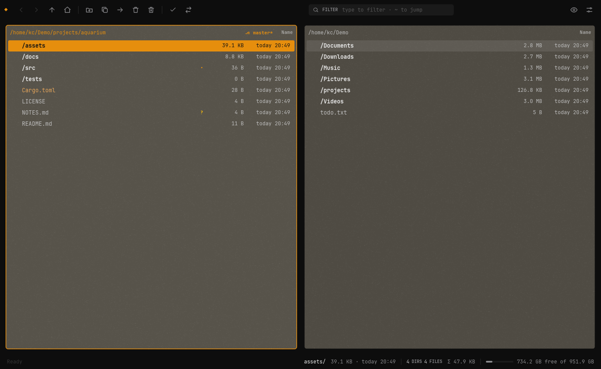
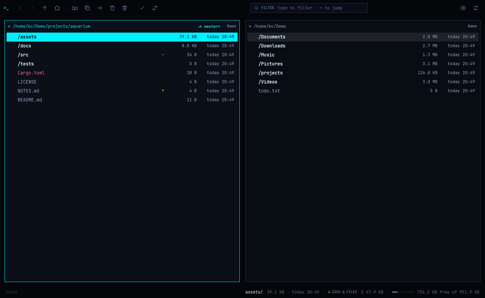
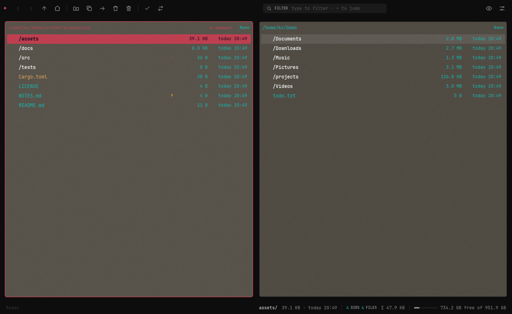

# Guppy

A two-pane file manager in the tradition of Norton Commander and Total Commander, written in
Rust with [iced](https://iced.rs). It starts in about a third of a second, stays out of your
way, and is meant to be driven from the keyboard: F5 copies, F6 moves, F7 makes a folder, and
typing filters the list.

I built it for my own Arch/Hyprland setup ([Omarchy](https://omarchy.org)), so by default it
picks up the colors of the active Omarchy theme. It also builds on Windows and macOS.



<p>
  
  
</p>
<sub>Left: the <code>neon</code> look. Right: <code>paper</code> following the Omarchy theme Aetheria.</sub>

## What it does

- Two panes, each with history, a filter as you type and fuzzy jumping (`~` or `/`, plus
  folders from zoxide if you have it)
- Copy, move, trash and delete run as background jobs with progress, a conflict dialog
  (skip, overwrite, keep both), pause and resume; Ctrl+Z undoes the last move, rename or trash
- Folder sizes are computed in the background and cached, so they are there next time
- Zip and tar archives open like folders (7z, rar and iso too, with bsdtar)
- Quick view next to the list (Ctrl+Q): text, images, PDF, video frames, audio tags, office docs
- Built-in viewer (F3) and editor (F4)
- Git status per file and the branch in the pane header
- Mark by pattern (`+`, `-`, `*`), permissions and owner (Alt+Enter), symlinks
- Files on the system clipboard, so copy/paste works with other file managers
- Drives and bookmarks (Alt+F1 / Alt+F2), command palette (Ctrl+P)
- Your own commands on keys, e.g. "open a terminal here" or "pack the marked files"
- Three looks: `paper` (Omarchy colors), `matte-black` and `neon`

## Building

You need a recent Rust toolchain (edition 2024).

```
cargo build --release
target/release/guppy-app
```

That gives you a single binary of about 15 MB; nothing else needs to be installed next to it.

## Keys

F1 shows all of them inside the app. The ones you'll use most:

| Key | |
|---|---|
| Tab | switch pane |
| Enter / Backspace | open / go up |
| Insert or Space | mark |
| F3 / F4 | view / edit |
| F5 / F6 | copy / move to the other pane |
| F7 | new folder |
| F8 or Del | move to trash (Shift: delete for good) |
| Ctrl+Z | undo |
| Ctrl+Q | quick view |
| Ctrl+P | command palette |
| Alt+F1 / Alt+F2 | drives and bookmarks |
| F12 | settings |

On a Mac it's Cmd instead of Ctrl.

## Settings

F12 changes the common ones. Everything lives in `~/.config/guppy/config.toml`, which Guppy
writes with comments on first start. Bookmarks and your own commands go there too:

```toml
[[bookmark]]
name = "Projects"
path = "~/Work/projects"

[[action]]
name = "Open terminal here"
key = "Ctrl+Alt+T"
command = "xdg-terminal-exec"

[[action]]
name = "Pack as tar.gz"
command = "tar czf archive.tar.gz %F"   # %F = marked files, %f = file under the cursor
```

## Optional programs

Guppy runs without anything else. A few extras use other programs when they are installed:

| Program | Used for |
|---|---|
| poppler | PDF preview |
| ffmpeg | video frames, audio tags and covers |
| ImageMagick | HEIC, AVIF, RAW, PSD … previews |
| bsdtar | 7z, rar and iso archives (already part of Windows and macOS) |
| git | git status in the list |
| zoxide | jumping to folders you use in the shell |

Settings → *Helper programs* shows what's there. Press Enter on a missing one and Guppy opens
a terminal with the install command for your system (pacman, apt, Homebrew or winget), or the
download page if there is no package manager.

## Windows and macOS

Both build with `cargo build --release` on the respective system and are checked by CI on
every push, but I use Guppy on Linux and haven't run it much elsewhere. Known differences:

- **macOS:** Cmd instead of Ctrl. Copying files puts file URLs on the clipboard like Finder
  does; cut only works when you paste in Guppy. Emptying the trash goes through Finder (macOS
  asks once for permission), and undo only brings back things trashed in the same session.
- **Windows:** Alt+Enter only toggles read-only, there is no owner. User commands run with
  `cmd /C`. Symlinks need developer mode or admin rights.
- **Both:** without Omarchy the colors are Matte Black.

## License

MIT, see [LICENSE](LICENSE). The bundled JetBrains Mono font is under the SIL Open Font
License (`crates/guppy-app/fonts/OFL.txt`).
